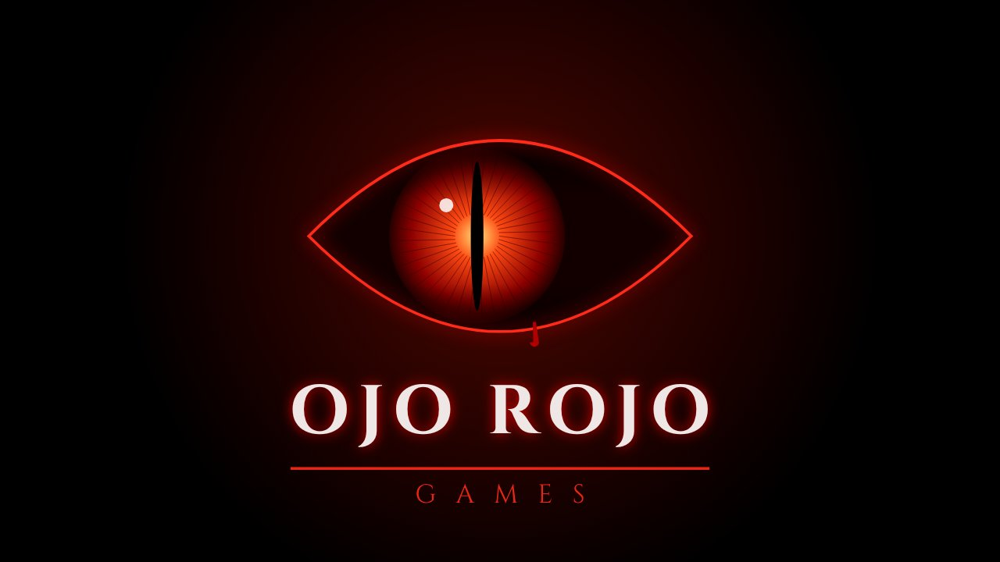
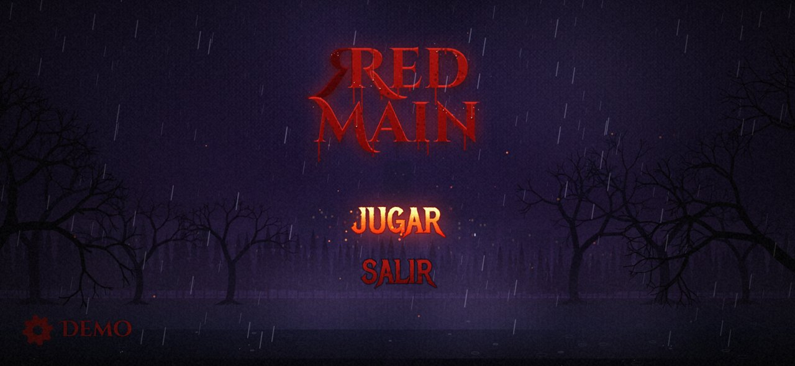

# Red Main — Ojo Rojo Games

Juego de terror para celular (Android). Esta primera entrega trae la **intro del estudio** y el **menú principal**.

| Intro "Ojo Rojo Games" | Menú (JUGAR resaltado) |
|---|---|
|  |  |

## Qué hay

- **Intro del estudio**: latidos en la oscuridad, un ojo de pupila rasgada que se abre, golpe de sonido, glitch y una lágrima de sangre. Se saltea tocando la pantalla.
- **Menú con tormenta**:
  - Bosque de pinos lejano, árboles muertos que se mecen con el viento y dos árboles grandes que enmarcan la pantalla.
  - Lluvia en tres capas de profundidad. Las gotas de adelante **chocan contra el letrero y los botones** (colisión por píxel): salpican, algunas **escurren por las letras** y caen desde los bordes.
  - Rayos con ramificaciones, iluminan nubes, lluvia y título; el **trueno llega con retraso según la distancia**, sacude la cámara y hace vibrar el celu.
  - Sangre que gotea del título, brasas que suben, niebla rasante, charcos con ondas, ciudad con reflejo en el agua.
  - Paralaje con el giroscopio (inclinando el celu) o el mouse.
- **Botones JUGAR / SALIR** con el "mouse over" de la referencia, adaptado al tacto: al apoyar el dedo se encienden en fuego. Se activan al soltar sobre el mismo botón.
- **Engranaje "Demo"** → Ajustes: música, efectos, intensidad de lluvia, rayos sí/no, vibración, calidad gráfica (baja/media/alta). Se guardan.
- **Audio 100% sintetizado** (WebAudio, sin archivos): lluvia, viento, truenos, drone oscuro y una melodía generativa de caja de música.
- Botón **atrás** de Android: cierra paneles, vuelve al menú o pide confirmación para salir.

## Estructura

```
./
  web/        el juego (HTML5 Canvas, sin dependencias); se puede abrir index.html en el navegador
  android/    proyecto Android nativo (WebView a pantalla completa, horizontal, inmersivo)
  tools/      make-icons.cjs: genera los íconos de la app
  docs/       capturas
```

## APK

Cada push a `main` dispara el workflow **Red Main APK** (`.github/workflows/apk.yml`), que compila el APK y lo publica en **Releases** del repo (`build-N`). Desde el celu: entrá a Releases, descargá `RedMain.apk` e instalalo (Android va a pedir permiso para "orígenes desconocidos").

Compilar a mano (con Android SDK instalado):

```bash
cd android
./gradlew assembleRelease
# → app/build/outputs/apk/release/app-release.apk
```

### Firma

El APK se firma con una clave **demo** incluida en `android/keystore/redmain-demo.jks` (contraseña `redmain-demo`), así cada versión nueva se instala encima de la anterior. Antes de publicar en Google Play hay que generar una clave propia y pasarla por variables de entorno / secrets: `RM_KEYSTORE`, `RM_KEYSTORE_PASSWORD`, `RM_KEY_ALIAS`, `RM_KEY_PASSWORD`.

## Créditos

Fuentes Cinzel, Cinzel Decorative y Metal Mania bajo SIL Open Font License (ver `web/fonts/OFL.txt`).
