# Red Main — Ojo Rojo Games

Juego de terror para celular (Android). Demo 0.6: **intro del estudio**, **menú principal** y la pantalla de **JUGAR** con tres modos (Historia, 1 Jugador y Online).

| Intro "Ojo Rojo Games" | Menú (JUGAR resaltado) |
|---|---|
|  |  |

## Qué hay

- **Intro del estudio**: latidos en la oscuridad, un ojo de pupila rasgada que se abre, golpe de sonido, glitch y una lágrima de sangre. Se saltea tocando la pantalla.
- **Menú con tormenta**:
  - Bosque de pinos lejano, árboles muertos que se mecen con el viento y dos árboles grandes que enmarcan la pantalla.
  - Lluvia en tres capas de profundidad. Las gotas de adelante **chocan contra el letrero y los botones** (colisión por píxel): salpican, algunas **escurren por las letras** y caen desde los bordes.
  - Rayos con ramificaciones, iluminan nubes, lluvia y título; el **trueno llega con retraso según la distancia**, sacude la cámara y hace vibrar el celu.
  - Sangre que gotea del título, brasas que suben, niebla rasante, charcos con ondas, ciudad con reflejo en el agua.
  - Paralaje con el giroscopio (inclinando el celu) o el mouse.
- **Botones JUGAR / SALIR** con el "mouse over" de la referencia, adaptado al tacto: al apoyar el dedo se encienden en fuego. Se activan al soltar sobre el mismo botón.
- **Engranaje "Demo"** → Ajustes: música, efectos, intensidad de lluvia, rayos sí/no, vibración, calidad gráfica (baja/media/alta). Se guardan.
- **Audio 100% sintetizado** (WebAudio, sin archivos): lluvia, viento, truenos, drone oscuro y una melodía generativa de caja de música.
- Botón **atrás** de Android: cierra paneles, vuelve al menú o pide confirmación para salir.

## Pantalla de JUGAR (demo 0.2)

| Selección de modo | Cargador propio |
|---|---|
| 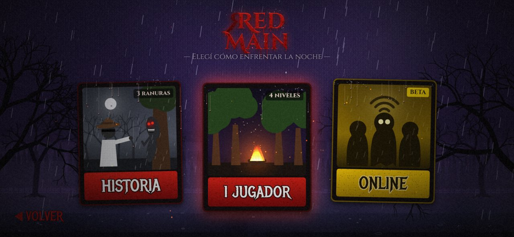 | 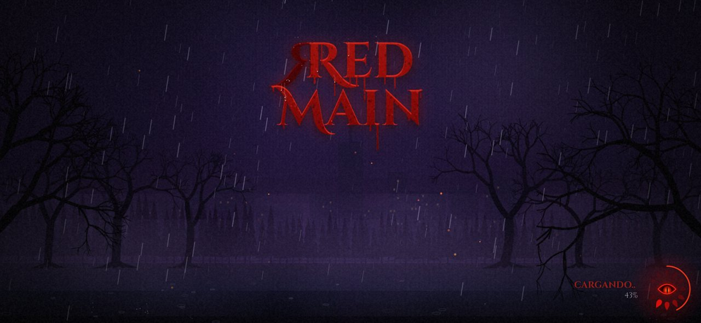 |
| **Historia — 3 ranuras** | **1 Jugador — 4 niveles** |
| 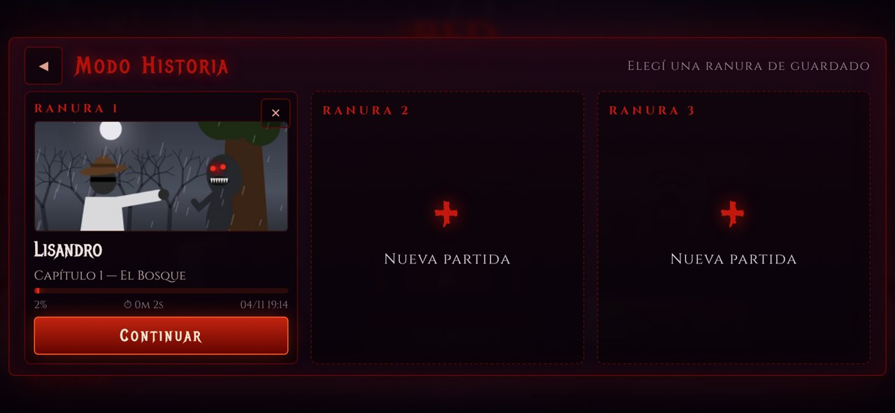 | 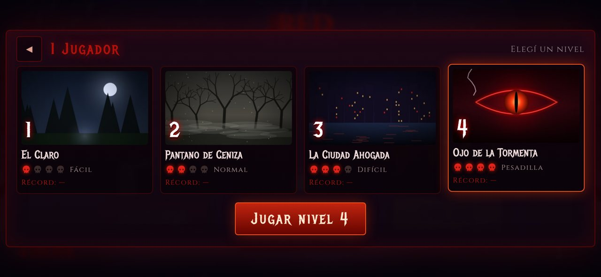 |
| **Online — servidores activos** | **Online — sala con chat** |
| 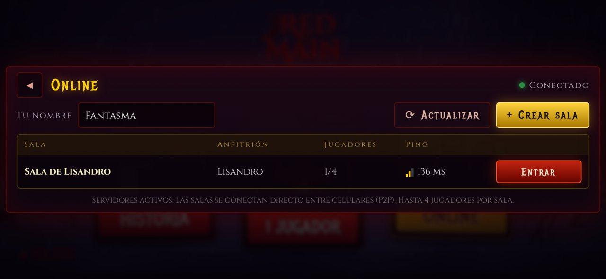 | 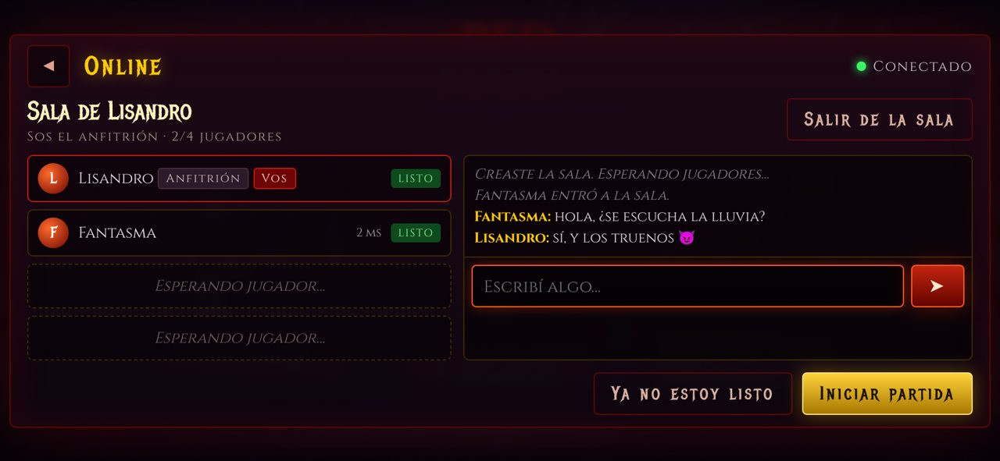 |

- **Cargador en el lugar**: al tocar JUGAR la escena no cambia. Los botones se desvanecen y en la esquina gira un ojo rojo con un anillo de gotas de sangre mientras se pre-renderizan de verdad las tarjetas y las miniaturas, repartidas entre frames para que no se trabe. Recién después aparecen los modos.
- **Selección de modo** (basada en el boceto): tarjetas ilustradas de HISTORIA, 1 JUGADOR (con la fogata animada) y ONLINE. La lluvia también choca contra ellas.
- **Modo Historia**: 3 ranuras de guardado (en el dispositivo). Cada partida nueva pide nombre y dificultad (Normal/Pesadilla). Cada ranura muestra capítulo, progreso, tiempo jugado y fecha, se puede continuar y se puede borrar (con confirmación). El progreso avanza solo mientras jugás la demo.
- **1 Jugador**: 4 niveles (El Claro, Pantano de Ceniza, La Ciudad Ahogada, Ojo de la Tormenta), cada uno con miniatura, dificultad en calaveras, descripción y récord.
- **Online (beta, funciona de verdad)**: buscador de salas activas con jugadores y ping, crear sala, entrar, lista de jugadores, chat, botón "Estoy listo" y el anfitrión inicia la partida para todos. Usa **PeerJS**: los celulares se conectan directo (P2P) y el servidor público de PeerJS solo los presenta, así que no hace falta montar un servidor propio. Hasta 8 salas a la vez, 4 jugadores por sala.
  - Para usar un servidor PeerJS propio: abrí el juego con `?peer=https://tu-servidor:443/` o guardá `{"url":"https://tu-servidor/"}` en `localStorage["redmain.peer"]`.

## Nivel 1 — El Castillo del Terror (demo 0.6)

**Castillo enorme**: 257×212 tiles (unas 10 veces el de la demo 0.4), **130 salas** en 5 alas (Norte, Sur, Este, Oeste y Central) con patios y cementerios a la intemperie. Se genera siempre igual (semilla fija), así todos los jugadores ven el mismo mapa. Hay casi 3500 muebles: bibliotecas, alcobas, cocinas, comedores, bodegas, mazmorras, armerías, galerías, estudios, salas de música con piano, baños con bañera de sangre, capillas, observatorios, establos, la Herrería, la Cripta, el Salón del Trono y el Gran Vestíbulo.

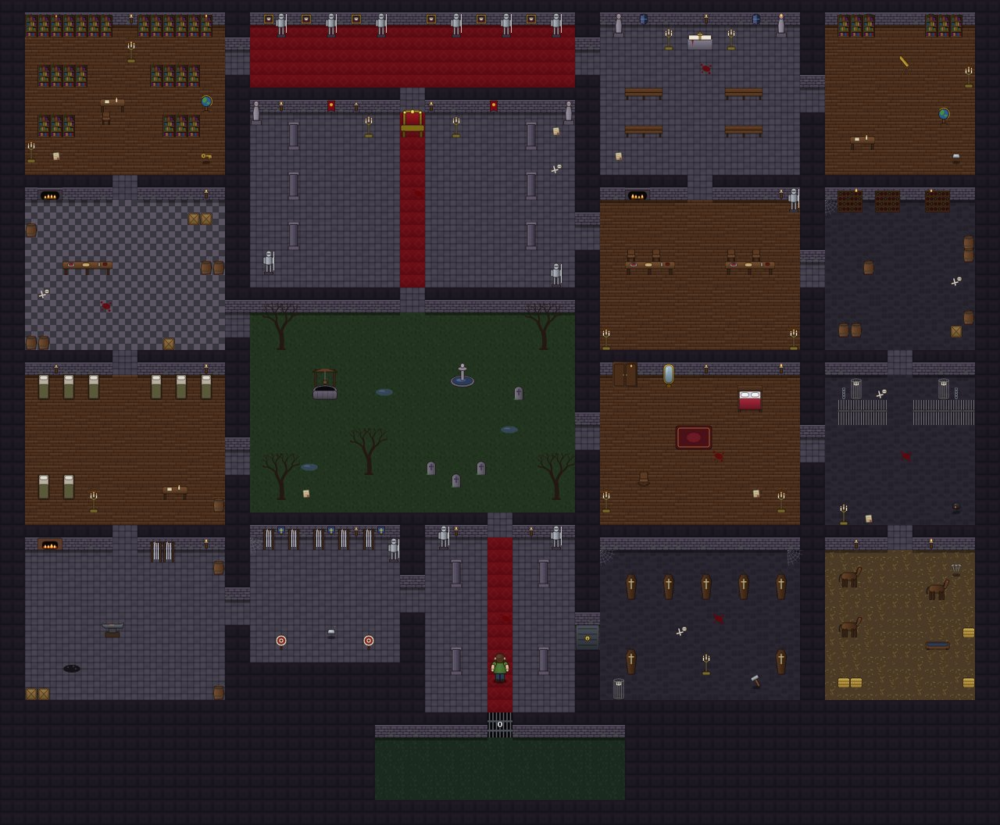

| De cerca: Gran Vestíbulo y alrededores |
|---|
| 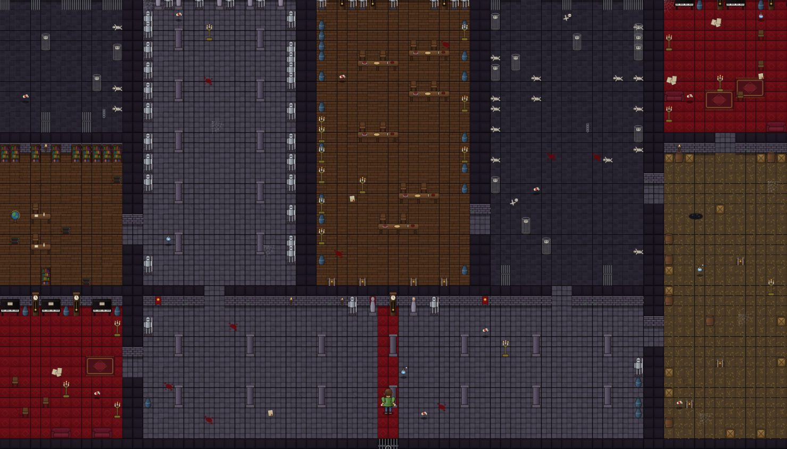 |

- **MAPA** (botón arriba a la derecha o tecla M): muestra solo las salas que ya exploraste (en cooperativo, las que exploró cualquiera del equipo), los objetos que viste, la Herrería y dónde está cada jugador.
- **Objetivo**: 2 lingotes de hierro, carbón, clavos de herradura y el martillo del herrero (en la **Cripta**, cerrada con llave). Las **notas** que hay por el castillo dicen en qué sala quedó cada cosa. Con todo, se forja la **herradura** en el yunque de la Herrería y se abre el **portón** del Gran Vestíbulo.
- **Vendas** y **agua bendita** repartidas por todo el castillo (se guardan en tu bolsillo, no son compartidas).
- **Animaciones**: respira quieto, parpadea, la cabeza se mece al caminar, brazos con inercia, polvo al correr; la Dama surge del humo desde el piso, inclina la cabeza hacia donde señala, el ojo espiral gira, deja una estela cuando corre y se deshace hacia arriba al irse; llamas que ondulan.
- **Protagonista redibujado** con contornos curvos, rodillas y codos, sombreado y detalles (lentes, barba, remera con estampa): caminar, correr, agacharse, **agacharse a agarrar objetos** (el objeto vuela al inventario), vendarse, forcejear, desangrarse y caer ([poses](docs/personaje.jpg)).
- Controles: joystick + CORRER / AGACHAR / ACCIÓN (+ VENDA cuando sangrás) en el celu; flechas o WASD, R, C, E, V, M y Esc en teclado.

### La Dama Blanca

| Dibujo (según el boceto) |
|---|
| 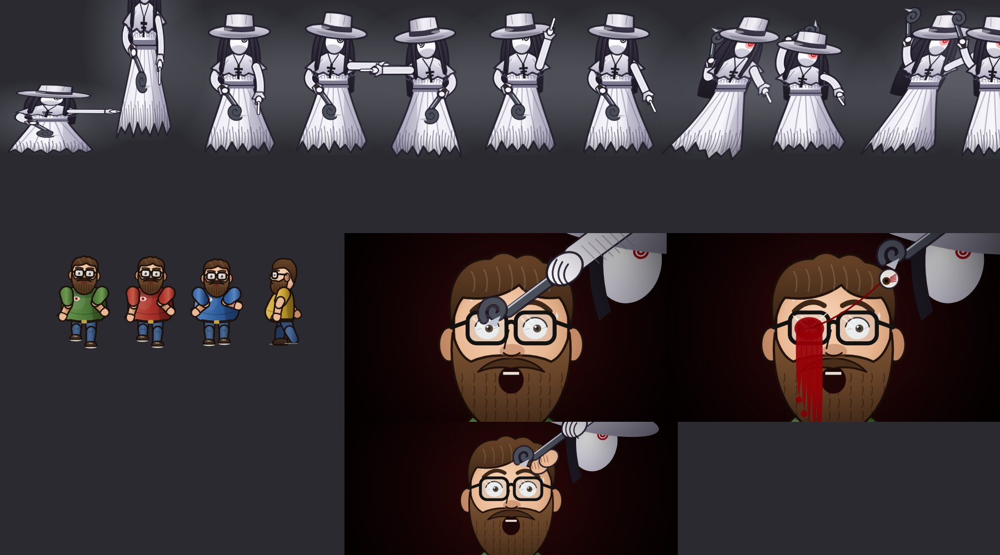 |

1. **Se escucha un garfio** arrastrándose por la piedra.
2. Aparece en una **nube de humo** exactamente **arriba, abajo, a la izquierda o a la derecha** del jugador y **le señala un camino**.
3. Si vas **para donde señala**, grita y **te persigue corriendo** (rápida: hay que correr). Si no le hacés caso (o te quedás quieto), **se clona**: cuatro Damas te rodean y te matan.
4. Cuando te alcanza **salta sobre vos** con el garfio. Te salvás tirándole **agua bendita** de cerca (el botón ACCIÓN se pone azul: AGUA) o escapándote lejos hasta que se esfuma.
5. Si te agarra: escena en primer plano de cómo **te clava el garfio en el ojo** y empezás a **desangrarte** (50 s). Te salva una **venda** o un **compañero** que se acerque y mantenga **CURAR**. Si no, morís.
   - **Seguís jugando pero ves mal**: imagen doble y borrosa, el lado del ojo herido oscuro, sangre que chorrea por la pantalla, parpadeos a negro y la cámara que se marea. Cuanto menos tiempo te queda, peor. Ya vendado, el ojo queda lastimado (se nota un poco) hasta que reintentes.

| Desangrándote · parpadeo · vendado · sin un ojo |
|---|
| 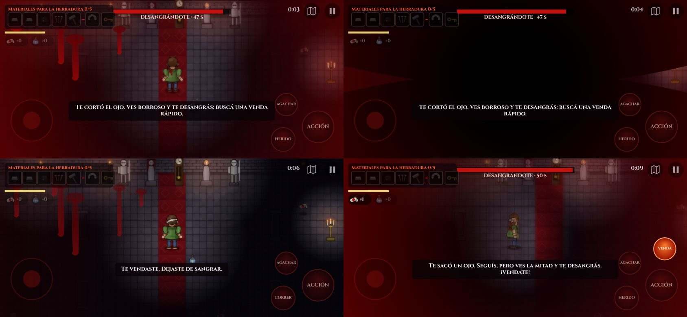 |

6. **Muy pocas veces** empieza un **forcejeo**: hay que tocar la pantalla muy rápido. Si ganás, se deshace en humo; si perdés, **te saca un ojo** (te sangra y desde ahí ves solo la mitad de la pantalla).

| Señala, persigue, salta, garfio, forcejeo, ojo, clones y muerte |
|---|
| 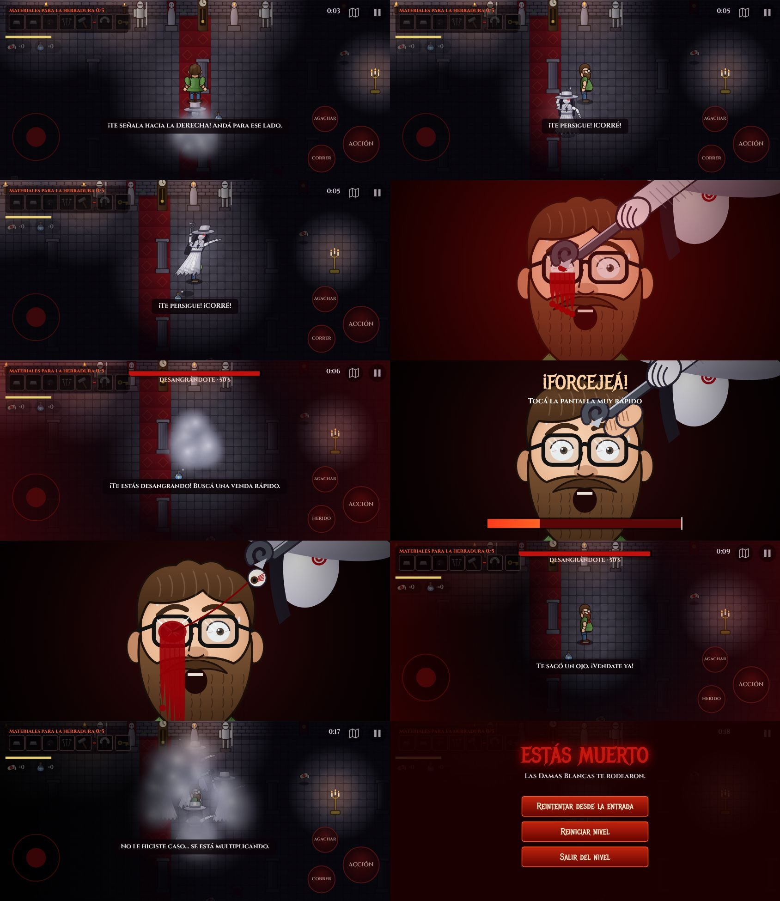 |

Solo: al morir podés reintentar desde la entrada conservando lo que juntaste.

## Cooperativo en red local (sin internet)

| Buscar / hostear | Sala | Jugando de a dos |
|---|---|---|
| 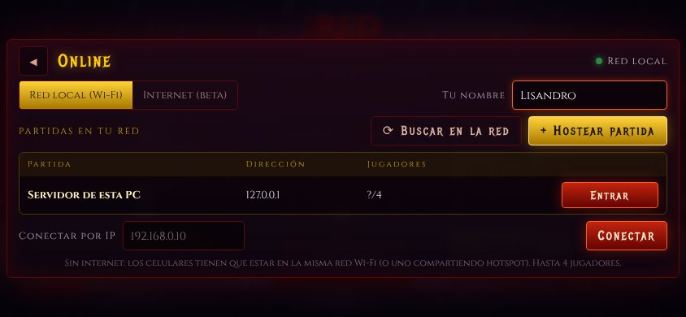 | 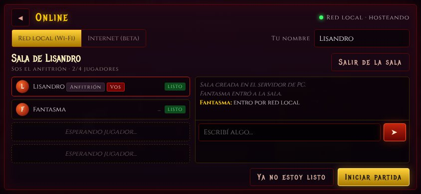 | 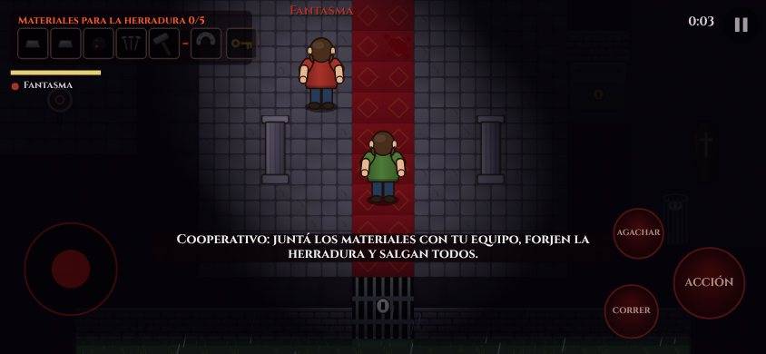 |

| Tres jugadores: la Dama elige a uno, el que no obedece muere y queda mirando, otro sangra y un compañero lo cura |
|---|
| 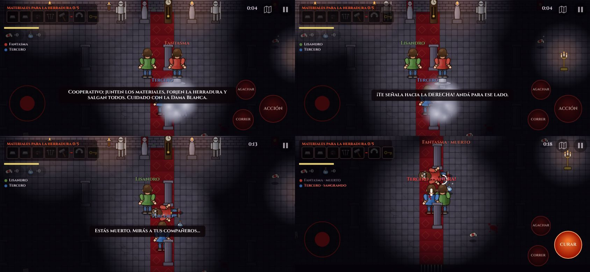 |

1. Los celulares en **la misma red Wi-Fi** (o uno comparte **hotspot** y el otro se conecta).
2. En uno: JUGAR → ONLINE → **Red local** → **Hostear partida**. La app levanta un servidor dentro del celu y muestra su IP.
3. En el otro: **Buscar en la red** (búsqueda automática por UDP) o escribí la IP en **Conectar por IP**.
4. En la sala: chat, **Estoy listo**, y el anfitrión toca **Iniciar partida**. Los dos cargan el castillo.

**Hasta 4 jugadores.** Qué se sincroniza: posiciones y animaciones de todos, **la Dama Blanca** (la maneja el anfitrión; elige a quién atacar, y todos la ven señalar, perseguir, saltar y clonarse), la salud de cada uno (sangrando, muerto, sin un ojo, vendado), curar a un compañero, objetos (si uno lo agarra, desaparece para todos; si dos lo agarran a la vez gana el primero), **inventario compartido**, llave y puerta de la cripta, forja de la herradura, portón y la salida: **ganan cuando salen todos los que siguen vivos** (los muertos miran a sus compañeros); si la Dama mata a todos, pierden. El anfitrión es la autoridad del mundo; si alguien se desconecta, los demás siguen.

**Desde una PC**: `node tools/lan-server.cjs "Mi sala"` levanta el mismo servidor; después en el navegador abrí `web/index.html`, Hostear partida (se conecta al servidor de esa PC) y los celulares se unen por la IP que muestra la terminal.

El modo **Internet (beta)** (PeerJS) sigue disponible en la otra pestaña y también juega el castillo cooperativo.

## Estructura

```
./
  web/        el juego (HTML5 Canvas); se puede abrir index.html en el navegador
    lib/      PeerJS 1.5.5 (MIT) para el online
    js/game/  nivel jugable: art.js (arte vectorial), hero.js (personaje), dama.js (la Dama Blanca), castle.js (generador del castillo), level.js (motor, IA y cooperativo)
    js/lan.js red local (cliente)
  android/…/LanServer.java  servidor de red local dentro de la app
  tools/lan-server.cjs      el mismo servidor para PC
  android/    proyecto Android nativo (WebView a pantalla completa, horizontal, inmersivo)
  tools/      make-icons.cjs: genera los íconos de la app
  docs/       capturas
```

## APK

Cada push a `main` dispara el workflow **Red Main APK** (`.github/workflows/apk.yml`), que compila el APK y lo publica en **Releases** del repo (`build-N`). Desde el celu: entrá a Releases, descargá `RedMain.apk` e instalalo (Android va a pedir permiso para "orígenes desconocidos").

Compilar a mano (con Android SDK instalado):

```bash
cd android
./gradlew assembleRelease
# → app/build/outputs/apk/release/app-release.apk
```

### Firma

El APK se firma con una clave **demo** incluida en `android/keystore/redmain-demo.jks` (contraseña `redmain-demo`), así cada versión nueva se instala encima de la anterior. Antes de publicar en Google Play hay que generar una clave propia y pasarla por variables de entorno / secrets: `RM_KEYSTORE`, `RM_KEYSTORE_PASSWORD`, `RM_KEY_ALIAS`, `RM_KEY_PASSWORD`.

## Créditos

PeerJS (MIT, ver `web/lib/PEERJS-LICENSE.txt`). Fuentes Cinzel, Cinzel Decorative y Metal Mania bajo SIL Open Font License (ver `web/fonts/OFL.txt`).
